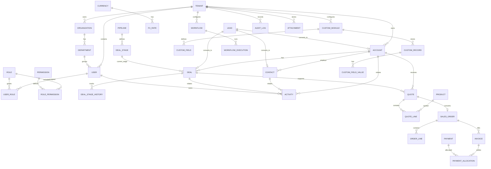

# Yonlink-CRM — 数据库 ER 设计基线

## 1. 建模原则

- PostgreSQL 为主数据库；所有业务表使用 UUID 主键。
- 所有租户业务表包含 `tenant_id`；租户 ID 从已验证的服务端上下文注入。
- 核心实体使用关系表；扩展属性使用 JSONB，但不把核心关系塞进 JSON。
- 金额使用 `NUMERIC(20,6)` 或按业务需要明确精度；币种使用 ISO 4217 代码。
- 时间统一存 UTC `timestamptz`；用户时区只影响展示。
- 核心业务表建议包含 `created_at/by`、`updated_at/by`、`version`、`deleted_at`（按软删除策略）。
- 对高频查询字段建立复合索引，索引前缀通常包含 `tenant_id`。
- 对强隔离部署启用 PostgreSQL Row Level Security（RLS），应用层授权仍必须保留。

## 2. ER 图（概念层）



## 3. 核心实体与关键字段

### 3.1 租户与组织
- `tenants(id, slug, name, status, base_currency, default_locale, default_timezone, authz_version, created_at)`
  - `authz_version`：租户级授权版本，见 §3.9。
- `organizations(id, tenant_id, name, legal_name, registration_no, country_code, default_locale, timezone)`
- `departments(id, tenant_id, organization_id, parent_id, name, manager_user_id, status, deleted_at)`
  - `status text NOT NULL DEFAULT 'active' CHECK (status IN ('active','inactive','deleted'))`；`deleted_at timestamptz NULL`；组合约束 `CHECK ((status = 'deleted') = (deleted_at IS NOT NULL))`。**有效部门** = `status = 'active' AND deleted_at IS NULL`（新增决定 A，§3.10.2）；`status` 必须 `NOT NULL`（CHECK 对 NULL 结果放行）。
  - `deleted` 为终态，禁止恢复为 `active`/`inactive`（新增决定 C）。
  - 提供 `UNIQUE (tenant_id, id)` 供复合外键引用；有任何成员关联时禁止停用或软删除（新增决定 B，§3.10）。
- `teams(id, tenant_id, name, description)`
- `users(id, tenant_id, email, username, password_hash, display_name, status, locale, timezone, authz_version, last_login_at)`
  - `authz_version`：用户级授权版本，见 §3.9。
  - 登录相关字段（`failed_login_count`、`locked_until`、`password_changed_at`、`mfa_enabled`）与唯一索引调整见 ADR-003，随决策 6 一并纳入正式字段清单。
- `user_departments(tenant_id, user_id, department_id, is_primary, created_at, created_by)`（决策 6-1 已批准，完整设计见 §3.10）
- `team_members(team_id, user_id)`
- `roles(id, tenant_id, name, parent_role_id, description)`
- `permissions(id, resource, action, scope)`
- `role_permissions(role_id, permission_id)`
  - 变更会递增 `tenants.authz_version`（§3.9）；`tenant_id`/`scope` 调整见第一轮审核建议，随决策 6 一并确认。
- `user_roles(user_id, role_id)`
- `record_shares(id, tenant_id, module_key, record_id, principal_type, principal_id, access_level, expires_at)`

### 3.2 CRM 核心
- `leads(id, tenant_id, owner_id, company_name, first_name, last_name, email, phone, source, status, rating, converted_account_id, converted_contact_id, converted_deal_id, converted_at)`
- `accounts(id, tenant_id, owner_id, parent_account_id, account_name, account_type, industry, website, phone, billing_address_id, shipping_address_id, lifecycle_stage)`
- `contacts(id, tenant_id, account_id, owner_id, first_name, last_name, email, phone, title, department, decision_role)`
- `deals(id, tenant_id, account_id, primary_contact_id, owner_id, pipeline_id, stage_id, name, amount, currency_code, base_amount, fx_rate_snapshot, probability, expected_close_date, closed_at, loss_reason)`
- `pipelines(id, tenant_id, name, is_default)`
- `deal_stages(id, tenant_id, pipeline_id, name, sequence, probability, is_won, is_lost)`
- `deal_stage_history(id, tenant_id, deal_id, from_stage_id, to_stage_id, changed_by, changed_at, duration_seconds)`

### 3.3 活动与时间线
- `activities(id, tenant_id, activity_type, subject, description, status, priority, owner_id, due_at, start_at, end_at, related_module, related_record_id)`
- `activity_participants(activity_id, user_id, participation_type)`
- `notes(id, tenant_id, related_module, related_record_id, body, created_by)`
- `attachments(id, tenant_id, storage_key, filename, mime_type, size_bytes, checksum, uploaded_by)`
- `record_attachments(attachment_id, module_key, record_id)`
- `timeline_events(id, tenant_id, actor_id, event_type, module_key, record_id, payload, occurred_at)`

### 3.4 产品、报价与财务
- `currencies(code, name, symbol, minor_unit, is_active)`
- `fx_rates(id, tenant_id, from_currency, to_currency, rate, effective_at, source, created_by)`
- `products(id, tenant_id, sku, name, description, unit, is_active)`
- `price_books(id, tenant_id, name, currency_code, is_default)`
- `price_book_entries(id, tenant_id, price_book_id, product_id, unit_price, valid_from, valid_to)`
- `quotes(id, tenant_id, quote_no, account_id, deal_id, owner_id, currency_code, subtotal, discount_total, tax_total, grand_total, base_currency_code, fx_rate_snapshot, status, valid_until)`
- `quote_lines(id, tenant_id, quote_id, product_id, description_snapshot, quantity, unit_price, discount, tax_rate, line_total)`
- `sales_orders(id, tenant_id, order_no, quote_id, account_id, currency_code, total_amount, status, ordered_at)`
- `order_lines(id, tenant_id, sales_order_id, product_id, quantity, unit_price, tax_rate, line_total)`
- `invoices(id, tenant_id, invoice_no, sales_order_id, currency_code, total_amount, due_date, status)`
- `payments(id, tenant_id, payment_ref, currency_code, amount, received_at, method, status)`
- `payment_allocations(id, tenant_id, payment_id, invoice_id, allocated_amount)`

### 3.5 自动化与审批
- `workflows(id, tenant_id, name, module_key, trigger_type, definition_json, version, status)`
- `workflow_executions(id, tenant_id, workflow_id, trigger_event_id, status, started_at, finished_at, retry_count, error_message, input_snapshot, output_snapshot)`
- `workflow_jobs(id, tenant_id, execution_id, job_type, payload, status, available_at)`
- `blueprints(id, tenant_id, module_key, name, definition_json, version, status)`
- `blueprint_instances(id, tenant_id, blueprint_id, record_id, current_state, entered_at)`
- `approval_requests(id, tenant_id, module_key, record_id, requester_id, status, submitted_at)`
- `approval_steps(id, tenant_id, approval_request_id, sequence, approver_id, decision, decided_at, comments)`
- `cadences(id, tenant_id, name, module_key, definition_json, status)`
- `cadence_enrollments(id, tenant_id, cadence_id, record_id, current_step, status, next_run_at)`

### 3.6 自定义元数据
- `custom_modules(id, tenant_id, api_name, label_key, plural_label_key, storage_strategy, status)`
- `custom_fields(id, tenant_id, module_id, api_name, label_key, data_type, required, unique_flag, config_json, display_order)`
- `custom_field_translations(id, tenant_id, field_id, locale, label, help_text)`
- `custom_records(id, tenant_id, module_id, owner_id, record_data_json, created_at, updated_at)`
- `custom_relationships(id, tenant_id, source_module_id, target_module_id, relationship_type, config_json)`
- `custom_field_values(id, tenant_id, record_id, field_id, value_text, value_number, value_date, value_json)`（仅在 EAV 查询需求明确时采用；需谨慎评估索引与性能）
- 自定义字段翻译和选项翻译单独存储，不能把显示文案当作稳定 API 标识。

### 3.7 国际化
- `locales(code, display_name, is_enabled)`
- `translation_entries(namespace, key, locale, value)`
- `tenant_locales(tenant_id, locale, is_default)`
- `user_preferences(user_id, locale, timezone, date_format, number_format)`
- 自定义字段、模块名、选项、邮件模板均使用稳定 key + locale 翻译值。
- 不对业务数据本身做机器翻译覆盖；可另存翻译副本。

### 3.8 安全与审计
- `audit_logs(id, tenant_id, actor_id, action, resource_type, resource_id, before_json, after_json, ip_address, user_agent, request_id, occurred_at)`
- `auth_sessions(id, tenant_id, user_id, session_token_hash, csrf_nonce, created_at, last_used_at, idle_expires_at, absolute_expires_at, remember_me, ip_address, user_agent, auth_method, mfa_verified_at, rotated_from_id, revoked_at, revoked_reason)`
  - 纯服务端会话（ADR-004，2026-11-08 决策）：仅保存 256 位 Session Token 的 SHA-256 哈希（`bytea(32)`，唯一索引），不保存明文；不使用 JWT / refresh token 作为浏览器会话。
  - 复合外键 `(tenant_id, user_id)` → `users`；索引 `(tenant_id, user_id) WHERE revoked_at IS NULL`、`(absolute_expires_at)`。
  - `absolute_expires_at` 创建时确定且不可延长；`idle_expires_at` 随活动节流更新（≤ 每 5 分钟写库）。
  - `revoked_reason` 取值受 CHECK 约束：`logout`、`rotated`、`evicted`、`password_changed`、`password_reset`、`user_disabled`、`role_changed`、`tenant_suspended`、`admin_revoked`、`expired_cleanup`（`password_reset` 为决策 6-2 新增，区分“经重置链接重置”与“登录后主动修改”）。
  - 会话解析发生在租户上下文建立前，只能经 `SECURITY DEFINER` 函数 `auth.resolve_session(token_hash)` 完成。
- `platform_operators(id, email, password_hash, display_name, status, failed_login_count, locked_until, password_changed_at, last_login_at, created_at)`（平台运维独立账号表，无 `tenant_id`；ADR-003）
- `platform_sessions(id, operator_id, session_token_hash, csrf_nonce, created_at, last_used_at, idle_expires_at, absolute_expires_at, ip_address, user_agent, rotated_from_id, revoked_at, revoked_reason)`（平台运维独立会话表；ADR-004）
- `system_settings(key, value, updated_at, updated_by)`（平台级配置，无 `tenant_id`；`key text PRIMARY KEY`，`value jsonb NOT NULL`；`yonlink_app` 只读，写入仅限迁移角色或平台运维受控接口）
  - 预置行 `authz.global_version`：全局授权版本，值为非负整数（初始 `0`），见 §3.9；
  - 预置行 `authz.cache_epoch`：权限缓存纪元，值为 UUID，见 §3.9；
  - 会话策略平台上下限（ADR-004 §2.4）等平台配置。
- `api_clients(id, tenant_id, client_id, secret_hash, scopes_json, status)`
- `webhooks(id, tenant_id, endpoint_url, event_types, secret_hash, status)`
- `webhook_deliveries(id, tenant_id, webhook_id, event_id, status, attempt_count, next_attempt_at, response_code)`

### 3.9 授权版本（ADR-004 方案 Y，2026-11-08 批准）
| 字段 | 类型与约束 | 递增触发（同一事务，数据库触发器实现） |
|---|---|---|
| `users.authz_version` | `bigint NOT NULL DEFAULT 0`，`CHECK (authz_version >= 0)` | `user_roles` 增删改；`user_departments` 增删改；未来用户级直接授权/字段权限覆盖 |
| `tenants.authz_version` | `bigint NOT NULL DEFAULT 0`，`CHECK (authz_version >= 0)` | `role_permissions` 增删改；`roles` 增删或 `parent_role_id` 变化；`departments.parent_id`、`status` 或 `deleted_at` 变化（§3.10.6）；租户级权限策略变化 |
| `system_settings['authz.global_version']` | `jsonb` 数值，非负整数，初始 `0` | `permissions` 增删改；系统预置角色模板定义变化；跨租户批量修改 `role_permissions` 的迁移/seed |
| `system_settings['authz.cache_epoch']` | `jsonb` 字符串（UUID） | 数据库从备份恢复后轮换（ADR-008 Runbook）；平台运维手动废弃权限缓存 |

规则：
1. 版本号**只增不减**，每次 +1；`BEFORE UPDATE` 触发器拒绝版本号变小。
2. 版本递增与权限变更**必须在同一数据库事务中提交**；采用语句级 `AFTER INSERT/UPDATE/DELETE` 触发器实现，应用代码不得自行维护版本号。
3. 修改 `permissions`/`role_permissions` 的迁移必须在同一迁移事务中递增 `authz.global_version`，由迁移检查（ADR-006）校验。
4. 版本号由 `auth.resolve_session()` 在单条语句中与会话状态一同读取，用于构造权限缓存键（ADR-004 §2.3.3）。
5. 用户禁用、租户停用、会话撤销不依赖版本号，由每请求 PostgreSQL 校验直接判定。
6. 版本递增触发器函数以 `SECURITY DEFINER`（属主 `yonlink_migrator`，固定 `search_path`）执行且只更新版本列/版本行，`yonlink_app` 无需获得 `tenants`、`system_settings` 的直接 UPDATE 权限。

### 3.10 用户部门关系与主部门约束（决策 6-1 及新增决定 A/B/C，2026-11-08 批准）

> 本节为决策 6-1 的完整设计。新增决定：A——部门状态字段；B——有成员关联时禁止停用/软删除；C——`deleted` 为终态（2026-11-08 负责人确认方案 A）。
> 标记“⏳ 待决策/待专项评审”的内容**不是**已批准规则。

#### 3.10.1 业务规则（已批准）
1. 用户可以没有任何部门（不强制关联部门）；一个用户可以关联一个或多个部门。
2. 同一用户最多只能有一个主部门。
3. 用户拥有一个或多个部门关系时，必须且只能有一个主部门；只有一个部门时，该部门必须是主部门。
4. 用户没有任何部门关系时，不要求存在主部门。
5. 部门关系只能指向同一租户内的**有效部门**；已停用、已软删除、不存在或属于其他租户的部门不得被关联。
6. **部门停用/软删除前置条件（决定 B）**：只要 `user_departments` 中存在该部门的**任何**关联记录，就禁止停用或软删除该部门。
   - 不区分关联用户是否启用、是否软删除；“用户已禁用”不是忽略其部门关联的理由。
   - 必须先移除该部门的全部成员关联；**不得**自动迁移成员，**不得**自动指定新的主部门。
   - 移除成员关联仍遵守第 2–4 条：移除后用户无其他部门 → 允许成为无部门用户；仍有其他部门 → 必须恰好保留（或在同一事务内指定）一个主部门。
   - 物理删除由复合外键 `NO ACTION` 阻止。
7. **软删除为终态（决定 C）**：部门进入 `deleted` 后不得恢复为 `active` 或 `inactive`；不得通过直接修改 `status` 或 `deleted_at` 绕过。Foundation 0.1 不提供部门恢复功能；未来如需恢复，必须另行提出架构决策（权限、审计、数据关联与并发安全评审），不得作为普通状态修改实现。
8. 不变量：`user_departments` 中的每一行都指向有效部门（由 D2 与 D4 共同维持）。
9. 以上规则全部由 PostgreSQL 强制执行；前端与应用层校验仅用于体验，不构成约束。
10. 用户与部门的关联只通过 `user_departments` 维护。

#### 3.10.2 `departments` 状态模型（决定 A、C）
| 字段 | 类型与约束 |
|---|---|
| `status` | **`text NOT NULL`** `DEFAULT 'active'` `CHECK (status IN ('active','inactive','deleted'))` |
| `deleted_at` | `timestamptz NULL` |
| 组合约束 | `CHECK ((status = 'deleted') = (deleted_at IS NOT NULL))` |

- **`status NOT NULL` 是必需约束**：PostgreSQL 的 CHECK 在表达式结果为 `NULL` 时视为通过，若 `status` 可为 `NULL`，`status IN (...)` 与组合约束都会得到 `NULL` 而放行。因此不能只依赖两条 CHECK。
- 完整合法性表（`status` 取 `active`/`inactive`/`deleted`/`NULL` 四种情况 × `deleted_at` 取 `NULL`/非 `NULL` 两种情况，**共 8 种组合，3 种合法，5 种非法**）：

| `status` | `deleted_at` | 结果 | 拒绝依据 | 含义 | 有效部门 |
|---|---|---|---|---|---|
| `active` | `NULL` | ✅ 合法 | — | 启用 | ✅ |
| `active` | 非 `NULL` | ❌ 非法 | 组合 CHECK | — | — |
| `inactive` | `NULL` | ✅ 合法 | — | 停用 | ❌ |
| `inactive` | 非 `NULL` | ❌ 非法 | 组合 CHECK | — | — |
| `deleted` | `NULL` | ❌ 非法 | 组合 CHECK | — | — |
| `deleted` | 非 `NULL` | ✅ 合法 | — | 已软删除（终态） | ❌ |
| `NULL` | `NULL` | ❌ 非法 | `NOT NULL`（CHECK 对 NULL 结果放行，不能依赖 CHECK） | — | — |
| `NULL` | 非 `NULL` | ❌ 非法 | `NOT NULL`（同上） | — | — |

- **有效部门**：`status = 'active' AND deleted_at IS NULL`（在上述约束下等价于 `status = 'active'`）。
- **允许的状态转换**：`active → inactive`、`inactive → active`、`active → deleted`、`inactive → deleted`（软删除同时写入 `deleted_at`）。
- **禁止的状态转换（D4 强制）**：`deleted → active`、`deleted → inactive`；`status = 'deleted'` 的行不得修改 `deleted_at`（含置空或改为其他时间）。
- 停用、软删除、重新启用均递增 `tenants.authz_version`（§3.10.6）。

#### 3.10.3 `user_departments` 数据模型
| 字段 | 类型与约束 | 说明 |
|---|---|---|
| `tenant_id` | `uuid NOT NULL` | 租户归属；只来自服务端上下文 |
| `user_id` | `uuid NOT NULL` | |
| `department_id` | `uuid NOT NULL` | |
| `is_primary` | `boolean NOT NULL DEFAULT false` | 主部门标识 |
| `created_at` | `timestamptz NOT NULL DEFAULT now()` | UTC |
| `created_by` | `uuid NULL` | 操作人（租户内 `users.id`，审计用途，不设外键） |

- 主键：`PRIMARY KEY (tenant_id, user_id, department_id)`——防止同一用户重复关联同一部门。
- 复合外键（`ON DELETE NO ACTION`）：
  - `FOREIGN KEY (tenant_id, user_id) REFERENCES users (tenant_id, id)`
  - `FOREIGN KEY (tenant_id, department_id) REFERENCES departments (tenant_id, id)`
  - 两条外键共享同一 `tenant_id` 列，用户与部门必然属于同一租户。
- 索引：
  - `user_departments_one_primary`：`UNIQUE (tenant_id, user_id) WHERE is_primary`（D1）
  - `user_departments_by_department`：`(tenant_id, department_id)`（成员查询、D4 存在性检查）
- 可更新列：仅 `is_primary`；键列不可更新（调整部门 = 删除旧关系 + 插入新关系）。键列不可更新由列级权限（§3.10.10）与 D2 双重保证。
- RLS：`ENABLE` + `FORCE ROW LEVEL SECURITY`；租户隔离策略（`FOR ALL`，`USING` 与 `WITH CHECK` 均为 `tenant_id = app.current_tenant_id()`，见 §3.10.5 与 ADR-005 §7）。

#### 3.10.4 数据库约束实现 D1–D4
部分唯一索引只能保证“最多一个主部门”，**不能保证“至少一个主部门”**，因此由以下数据库对象共同实现：

| 层 | 数据库对象 | 时机 | 实现要点 |
|---|---|---|---|
| D1 | 部分唯一索引 `user_departments_one_primary` | 每行写入时立即 | 同一 `(tenant_id, user_id)` 下 `is_primary = true` 最多一行；数据库层最终防线，不依赖 NestJS 判断；唯一索引检查本身并发安全 |
| D2 | `user_departments` 的 `BEFORE INSERT OR UPDATE OR DELETE` 行级触发器 `user_departments_guard` | 每行写入/删除前 | ① 公共检查（§3.10.5）；② UPDATE 时拒绝修改 `tenant_id`、`user_id`、`department_id`；③ **锁用户行** `FOR NO KEY UPDATE`（`NEW` 或 `OLD` 的 `tenant_id, user_id`），不存在或不可见则报错；④ **仅 INSERT**：对部门行取 `FOR SHARE`，确认部门属于当前租户且 `status = 'active'`，否则报错。授权版本由 §3.9 语句级触发器在同一事务内维护 |
| D3 | `CONSTRAINT TRIGGER user_departments_primary_check AFTER INSERT OR UPDATE OR DELETE ... DEFERRABLE INITIALLY DEFERRED FOR EACH ROW` | **事务提交前** | ① 公共检查；② 对受影响用户计算 `n = count(*)`、`p = count(*) FILTER (WHERE is_primary)`；③ 要求 `n = 0 OR p = 1`，否则报错，整个事务回滚 |
| D4 | `departments` 的 `BEFORE UPDATE OF status, deleted_at` 行级触发器 `departments_status_guard`；复合外键 `NO ACTION` | 部门 `status`/`deleted_at` 出现在 UPDATE 中时 | ① 公共检查；② **终态**：若 `OLD.status = 'deleted'`，且 `NEW.status` 或 `NEW.deleted_at` 与旧值不同 → 报错；③ **成员前置条件**：若 `OLD.status = 'active'` 且 `NEW.status <> 'active'`，或 `OLD.status = 'inactive'` 且 `NEW.status = 'deleted'`，则检查 `EXISTS (SELECT 1 FROM user_departments WHERE tenant_id = OLD.tenant_id AND department_id = OLD.id)`，存在任何行即报错（不联查用户状态）；④ 物理 `DELETE` 由外键 `NO ACTION` 拒绝 |

D3 说明：
- 延迟到提交前执行，事务内允许临时“无主部门”的中间状态（例如先删除旧主部门、再指定新主部门），不会误拒绝合法事务。
- 每个受影响用户可能被检查多次（每行一次），结果幂等。
- D2 持有该用户行的 `FOR NO KEY UPDATE` 锁直到事务结束，提交阶段不存在其他事务并发修改同一用户的部门关系，D3 看到的就是该用户的真实最终状态。

#### 3.10.5 公共检查与 RLS 兼容性（D2、D3、D4 均执行）
1. **安全属性**：函数为 `SECURITY INVOKER`、`VOLATILE`、固定 `search_path`；以 `yonlink_app` 身份执行，受 FORCE RLS 与列级权限约束。
   - **禁止**改为 `STABLE/IMMUTABLE`：`VOLATILE` 函数在 `READ COMMITTED` 下每条语句取新快照，D3/D4 的计数/存在性查询才能看到并发事务**已提交**的行；`STABLE` 沿用调用语句的快照，会漏看。
2. **租户上下文检查（fail-closed）**：通过 `app.current_tenant_id()` 读取上下文（实现为 `NULLIF(current_setting('app.tenant_id', true), '')` 并做 UUID 格式校验），覆盖：
   - **缺失**（未设置或空字符串——自定义参数在事务级设置结束后会以空字符串残留在会话中）→ 报错；
   - **格式错误**（非 UUID）→ 报错，不得静默转换；
   - **与记录租户不一致**（`NEW/OLD.tenant_id` ≠ 上下文）→ 报错；
   - **事务中途切换**：若写入 A 租户行后切换为 B，提交时 D3 对 A 行的检查发现不一致 → 回滚。⚠️ 仅依靠普通 GUC 时，“A → B → A” 在提交前切回的情况**无法被数据库检测**；可信的“一个事务只设置一次”机制尚待专项评审（ADR-005 §7.2）。
   - 在上下文与记录一致的前提下，同一用户的全部部门关系与该用户同属一个租户（复合外键保证），RLS 不会隐藏与判断相关的行，D3/D4 的计数结果完整。
3. **隔离级别检查（fail-closed）**：`current_setting('transaction_isolation')` 必须为 `read committed`，否则报错。
   - 原因：在 `REPEATABLE READ` 下，部门停用事务的快照可能早于并发成员插入的提交，D4 的 `EXISTS` 会**漏看**已提交的成员关系，破坏“有成员不得停用”。这是快照语义导致的漏检，**不是可以靠重试解决的问题**，因此直接禁止，而不是“提高隔离级别后重试”。
   - ADR-004 §2.3.3 中权限缓存未命中时使用的**只读** `REPEATABLE READ` 事务不写入 `user_departments`/`departments`，不触发 D2–D4，与本规则不冲突。
4. **公共检查不是身份认证**：它只证明“本次写入的行与事务声明的租户上下文一致”，不证明调用者有权使用该租户（见 §3.10.11）。
5. 无法绕过：触发器挂在表上；`yonlink_app` 不是表属主，不能 `ALTER TABLE ... DISABLE TRIGGER`；`session_replication_role` 需要超级用户。

#### 3.10.6 授权版本与数据范围
| 变更 | 递增 | 机制 |
|---|---|---|
| `user_departments` 新增、删除、`is_primary` 变更 | 受影响用户的 `users.authz_version` | §3.9 语句级触发器，同一事务 |
| `departments.parent_id` 变化 | `tenants.authz_version` | §3.9，同一事务 |
| `departments.status` 或 `deleted_at` 变化（停用、软删除、重新启用） | `tenants.authz_version` | §3.9，同一事务 |

- 停用/软删除前该部门必须没有任何成员关联，因此**不会有用户因该部门获得 `department` 范围**，也不存在“通过已停用部门保留的历史部门授权”。
- 部门状态任何变化都递增 `tenants.authz_version`，因此无论 6-8 最终如何定义部门树遍历，权限缓存都不会沿用旧结果。
- 部门树遍历是否经过非有效节点、上下级部门停用规则等，属于 6-8 待决事项（§3.10.12），本节不作规定。
- 未来业务记录若带 `department_id` 归属，指向非有效部门的记录如何展示与授权，由对应模块（CRM 0.2 起）的 ADR 规定。
- 会话有效性仍按 ADR-004 每请求由 PostgreSQL 判定；Valkey 不缓存会话有效性，权限缓存键包含版本组合。

#### 3.10.7 事务流程、加锁模式与顺序
所有操作均在 `withTenantTx`（`READ COMMITTED`）内的**单个事务**中完成，并在同一事务内写审计日志。适用于 API、Worker 与所有后台任务。

**行锁模式**
| 对象 | 锁模式 | 由谁获取 | 冲突关系（PostgreSQL 行级锁） |
|---|---|---|---|
| 用户行 `users` | `FOR NO KEY UPDATE` | 应用服务显式获取（先锁后读）；D2 兜底获取 | 与 `FOR SHARE`、`FOR NO KEY UPDATE`、`FOR UPDATE` 冲突；不与外键检查使用的 `FOR KEY SHARE` 冲突 |
| 部门行（新增成员时） | `FOR SHARE` | D2（仅 INSERT） | 与 `FOR NO KEY UPDATE`、`FOR UPDATE` 冲突；多个新增成员事务之间相互兼容 |
| 部门行（停用/软删除时） | `FOR NO KEY UPDATE` | 应用服务显式 `SELECT ... FOR NO KEY UPDATE`；随后的 `UPDATE`（未修改键列）本身也取得同级锁 | 与新增成员的 `FOR SHARE` **冲突**；不使用 `FOR KEY SHARE`（与 `FOR NO KEY UPDATE` 不冲突，无法提供所需互斥） |

以上加锁语句均需要 `yonlink_app` 具备相应表至少一列的 UPDATE 权限，见 §3.10.10。

**流程 F1：单个用户的部门关系变更**
1. 显式锁用户行：`SELECT ... FROM users WHERE tenant_id = $t AND id = $u FOR NO KEY UPDATE`；不存在/不可见 → 404。
2. 持锁读取该用户全部部门关系，计算变更。
3. 按固定语句顺序修改：
   - 主部门变更：**先**取消或删除旧主部门，**再**设置新主部门（D1 为立即检查，顺序相反将违反唯一索引）；
   - 删除主部门且仍有其他部门：同一事务内必须指定新主部门（API 参数必填）；
   - 删除唯一部门：允许，用户变为无部门；
   - 新增第一个部门：以 `is_primary = true` 插入；
   - 插入新部门关系时，D2 在用户锁之后对目标部门取 `FOR SHARE`（顺序：用户 → 部门）。
4. 提交：D3 校验最终状态；版本递增与审计在同一事务内。

**流程 F2：批量用户部门变更（多个用户）**
1. 在第一条写语句之前，按 `(tenant_id, user_id)` **升序**、**逐条语句**显式锁定全部涉及用户（每个用户一条 `SELECT ... FOR NO KEY UPDATE`），不依赖多行 SQL 的执行计划或触发器的行处理顺序。
2. 全部用户锁获取后再执行部门关系修改（D2 的再次加锁为同一事务内重入，不产生新的等待）；目标部门的 `FOR SHARE` 在用户锁之后获取。
3. 提交时 D3 逐用户校验。

**流程 F3：部门停用或软删除**
1. 显式锁部门行：`SELECT ... FROM departments WHERE tenant_id = $t AND id = $d FOR NO KEY UPDATE`。
2. 更新状态（`inactive`，或 `deleted` + `deleted_at`）；D4 检查终态与成员关联，任一不满足 → 失败。
3. 版本递增触发器在同一事务内递增 `tenants.authz_version`（锁 `tenants` 行）。
4. F3 不锁任何用户行（成员必须为空）；不自动移除、迁移成员。

**全局加锁顺序**：`users`（按 `user_id` 升序）→ `departments` → `tenants`。

**数据库强制 vs. 调用方必须遵守的编排规则**
| 规则 | 数据库是否强制 | 说明 |
|---|---|---|
| 同一用户的部门关系写入串行化 | ✅ D2 对用户行加锁 | 即使绕过应用服务也成立 |
| 新增成员与部门停用/软删除互斥 | ✅ D2 `FOR SHARE` 与停用的 `FOR NO KEY UPDATE` 冲突 + D4 | |
| 主部门规则、终态规则、成员前置条件 | ✅ D1、D3、D4 | |
| `READ COMMITTED`、上下文与记录一致 | ✅ 公共检查 | |
| “先锁后读”（读取-计算-写入基于最新状态） | ❌ 调用方规则 | 违反时 D3 仍阻止不一致状态提交，但可能产生不必要的失败 |
| 多用户事务在首条写语句前按 `user_id` 升序加锁 | ❌ 调用方规则 | 数据库无法强制加锁顺序 |
| 混合事务中先完成用户与部门相关加锁和写入，最后执行会递增 `tenants.authz_version` 的租户级授权变更 | ❌ 调用方规则 | 违反将引入死锁路径（§3.10.9） |
| 一个 API 操作一个事务，不得为规避锁顺序拆分事务 | ❌ 调用方规则 | |
| API、Worker、后台任务遵守相同锁顺序 | ❌ 调用方规则 | |
| `40P01`/`40001` 回滚并重新执行完整事务，最多 3 次 | ❌ 调用方规则 | 不得只重试最后一条 SQL |

- 调用方规则通过统一的 `withTenantTx` 事务封装、代码评审与集成测试（U24、U29）保障；**重试只是兜底，不能替代正确的锁顺序，也不能彻底消除死锁**。

#### 3.10.8 并发安全论证
**(a) 新增成员（事务 M，向部门 D 插入关系）与停用/软删除 D（事务 X）**
| 先后 | 过程 | 结果 |
|---|---|---|
| M 先持有 D 的 `FOR SHARE` | X 的 `FOR NO KEY UPDATE`（或 UPDATE）阻塞至 M 结束。M 提交 → X 获锁后，D4 中的 `EXISTS`（`VOLATILE` + `READ COMMITTED`，取新快照）看到 M 已提交的关系 → X 失败。M 回滚 → X 成功 | 只有“M 成功、D 保持有效”或“M 回滚、X 成功” |
| X 先持有 D 的 `FOR NO KEY UPDATE` | M 在 D2 的 `FOR SHARE` 处阻塞至 X 结束。X 提交 → 加锁 SELECT 返回最新版本 `status <> 'active'` → M 失败。X 回滚 → M 读到 `active` → 成功 | 只有“X 成功、M 失败”或“X 回滚、M 成功” |
| M 已在 X 开始前提交 | X 的 D4 直接看到成员关系 → X 失败 | 部门保持有效 |
| X 已在 M 开始前提交 | M 的 D2 读到非有效部门 → M 失败 | 部门保持停用/删除 |

不存在“成员新增成功且部门停用成功”的结果。该论证依赖 `READ COMMITTED` 与 `VOLATILE`，二者由 §3.10.5 的公共检查与迁移检查（ADR-006）在数据库层强制。

**(b) 同一用户的两个并发事务 T1、T2**：二者都必须先取得同一用户行的 `FOR NO KEY UPDATE`（显式或经 D2），T2 等待 T1 结束；T2 获锁后的读取看到 T1 已提交结果，D3 在 T2 的最终状态上校验。D1 拦截“两个主部门”，D3 拦截“有部门无主部门”。

**(c) 删除成员与停用部门**：X 的 D4 若看到尚未提交删除的成员行仍存在 → 保守失败；删除提交后再停用即成功。

**(d) 已删除部门**：`deleted` 为终态，任何并发事务都无法通过修改 `status`/`deleted_at` 使其重新有效，因此不存在“恢复后被并发关联”的路径。

#### 3.10.9 死锁路径检查
| 路径 | 是否可能死锁 | 处理 |
|---|---|---|
| F1 vs F1（不同用户） | 否：各自锁不同用户行；部门 `FOR SHARE` 相互兼容 | — |
| F1/F2 vs F3 | 否：F3 只锁部门与租户行；F1/F2 持有用户锁时等待部门锁，而 F3 不等待任何用户锁 | — |
| F2 vs F2 | 否：均按 `user_id` 升序逐条加锁 | 测试 U24 |
| F3 vs F3（同一租户不同部门） | 否：各锁不同部门行后在语句末尾等待同一 `tenants` 行，为普通等待而非环 | — |
| **混合事务**：先执行租户级授权变更（语句末尾锁 `tenants` 行），再停用部门或新增成员（锁部门/用户行），与 F3 交叉 | **可能**：违反 `users → departments → tenants` | 调用方规则：会递增 `tenants.authz_version` 的操作放在事务最后；仍发生的 `40P01` 由完整事务重试兜底 |
| **跨用户混合事务**：先为用户 A 修改角色（`user_roles` 语句末尾锁 A 行）再为用户 B 修改部门，另一事务顺序相反 | **可能**：违反用户升序 | 调用方规则：首条写语句前按升序显式锁定全部涉及用户 |
| 与登录失败计数更新（`users` 行）并发 | 否：登录路径只锁单个用户行且不等待其他锁 | 可能短暂等待 |

#### 3.10.10 数据库权限与行级锁（`yonlink_app` 最小权限）
PostgreSQL 规定：`SELECT ... FOR UPDATE / FOR NO KEY UPDATE / FOR SHARE / FOR KEY SHARE` 除 `SELECT` 权限外，还要求对被锁表**至少一列**拥有 `UPDATE` 权限；在启用 RLS 的表上，加锁的 `SELECT` 同时受 `SELECT` 与 `UPDATE` 策略的 `USING` 约束。由于 D2–D4 为 `SECURITY INVOKER`，这些权限由 `yonlink_app` 本身承担。

| 表 | 加锁需求 | `yonlink_app` 权限设计（列级授权，不授予全表 UPDATE） | 结论 |
|---|---|---|---|
| `users` | D2、F1/F2：`FOR NO KEY UPDATE` | `SELECT`；列分三类：<br>① **应用可直接更新**（列级 UPDATE 授予 `yonlink_app`）：`display_name`、`locale`、`timezone`；<br>② **受控业务操作**（只能经指定应用服务完成，并在同一事务内撤销会话、写审计等）：`status`、`deleted_at`、`email`、`username`、`password_hash`、`failed_login_count`、`locked_until`、`password_changed_at`、`last_login_at`——其中**经重置链接重置密码**时 `password_hash`、`password_changed_at`、`failed_login_count`、`locked_until` 由 `auth.consume_password_reset`（`SECURITY DEFINER`，§3.11.6）更新（决策 6-2）；其余场景（登录后主动修改密码、登录失败计数等）的数据库授权方式（列级授予 `yonlink_app`，或经 `SECURITY DEFINER` 函数）**⏳ 随 6-10 决定**；<br>③ **永不授予**：`id`、`tenant_id`、`authz_version`（仅 §3.9 版本触发器维护）、`created_at` | 第①类的列级 UPDATE 授权即满足加锁要求，**无需为加锁额外扩大权限** |
| `departments` | D2：`FOR SHARE`；F3：`FOR NO KEY UPDATE` | `SELECT`、`INSERT`；`UPDATE` 仅授予部门管理所需列：`name`、`manager_user_id`、`parent_id`、`status`、`deleted_at`。**不授予**：`id`、`tenant_id`、`organization_id`、`created_at` | 部门管理本身需要这些列，加锁要求随之满足；`status`/`deleted_at` 的修改受 D4 约束 |
| `user_departments` | 无 | `SELECT`、`INSERT`、`DELETE`；`UPDATE` 仅 `is_primary` | 键列不可更新由列级权限与 D2 双重保证 |
| `tenants` | 版本递增（`SECURITY DEFINER` 触发器，以 `yonlink_migrator` 执行） | `SELECT`（受 RLS）；**不授予 UPDATE** | `yonlink_app` 不直接锁或修改 `tenants` 行 |

配合关系：
- **列级权限**决定 `yonlink_app` 能写哪些列以及能否加锁；**RLS**（`FOR ALL` 租户策略）决定能看到、锁定、写入哪些行；**SECURITY INVOKER 触发器**以同一身份执行，因此同时受两者约束，不形成旁路；**SECURITY DEFINER** 仅用于版本递增触发器，只更新版本列/版本行。
- 拥有某列的 UPDATE 权限意味着应用可直接写该列；业务约束（终态、成员前置条件、主部门规则）由触发器在数据库层保证，用户级授权（谁能管理部门）由应用层 RBAC 保证。
- 若未来出现“只需加锁、无任何业务可更新列”的表，**不得**为满足加锁而授予无关列的 UPDATE 权限，须另行评审（例如受控的 `SECURITY DEFINER` 加锁函数），并更新 ADR-005。
- 本节在当前范围内未发现与最小权限原则冲突的情况；`users` 认证相关列在重置路径中的更新方式已由 6-2 确定（§3.11.6），其余场景的最终授权方式随 6-10 决策确定。
- 集成测试必须以真实 `yonlink_app` 角色及上述列级授权执行（ADR-009 U31–U33），不得使用表属主或管理员角色验证触发器与加锁。

#### 3.10.11 租户上下文的可信边界（详见 ADR-005 §7）
- **租户身份来源**：调用者能使用哪个租户，由应用层完成身份认证（ADR-003/004：会话由 PostgreSQL 权威判定）与租户访问授权后确定；客户端提交的租户 ID 不是可信授权结果。
- **`app.tenant_id` 的作用**：仅用于把应用层已确定的租户传递给 RLS 与触发器。由于所有请求共用 `yonlink_app` 角色，而 PostgreSQL 允许任何会话设置自定义参数，**普通 GUC 不能证明调用者有权选择该租户**；数据库的上下文一致性检查**不是**租户身份认证。
- **一次设置、不得切换**：当前文档化的机制（`withTenantTx` 封装 + D3 提交时一致性检查）只能检测“写入 A 行后切换到 B 并提交”的情况，**不能**检测 “A → B → A”；也不能仅靠一个普通 `SECURITY INVOKER` 设置函数阻止调用者再次调用 `set_config`。**⏳ 数据库级强制机制待专项技术评审**（备选方案见 ADR-005 §7.2），在评审完成前不得宣称已具备该保证。
- **连接池**：只允许事务级设置（`set_config(..., true)`），禁止会话级 `SET`；提交、回滚、出错后上下文自动失效（残留为空字符串，`app.current_tenant_id()` 视为缺失）；连接归还连接池前由事务封装确认已无未结束事务；下一个事务不得继承上一个事务的上下文（ADR-009 R7、U34）。

#### 3.10.12 与 6-8（部门数据权限与部门树范围）的边界
以下事项属于决策 6-8，**6-1 不作任何规定，均未批准**：
- 存在下级部门时，上级部门能否停用或软删除；
- 是否在上级停用时自动停用下级、是否必须先删除全部下级、是否自动迁移下级；
- 部门树遍历是否经过非有效节点，`department_tree`/`subordinates` 等范围值的定义与启用。

在 6-8 决策前，D4 只检查成员关联与终态，不检查下级部门。

### 3.11 密码重置与事务性邮件 Outbox（决策 6-2 方案 A，2026-11-09 批准）

> 本节为决策 6-2 的完整数据设计；会话处理见 ADR-004 §2.4，数据库访问模型见 ADR-005 §9，测试见 ADR-009 §3.5B。
> 标记“⏳ 待决策/待专项评审”的内容**不是**已批准规则。

#### 3.11.1 已批准规则摘要
| # | 规则 |
|---|---|
| 1 | 租户管理员可为**本租户**用户发起密码重置；必须具备本租户相应管理权限；不得跨租户；重置邮件发送给目标用户；记录发起管理员、目标用户、租户与时间 |
| 2 | 普通租户用户可通过邮箱自助申请重置，无需登录；不得泄露账号是否存在 |
| 3 | 平台运维账号不使用租户用户的邮箱自助流程，由其他平台管理员或服务器命令行处理；不得经租户管理员接口重置；数据与权限边界隔离 |
| 4 | 开发环境使用本地邮件替身；生产环境的邮件重置必须配置 SMTP |
| 5 | 256 位密码学安全随机令牌；`password_reset_tokens` 只保存 SHA-256 哈希 |
| 6 | 自助重置令牌有效期 30 分钟 |
| 7 | 管理员发起的重置令牌有效期 24 小时 |
| 8 | 令牌只能成功消费一次，数据库层防止并发重复消费 |
| 9 | 令牌经 URL fragment 传递；`Referrer-Policy: no-referrer`；前端及时清理 fragment；日志不得泄露令牌 |
| 10 | 申请接口统一返回 HTTP 202，不泄露账号是否存在 |
| 11 | 限速：同一账号每小时 3 次、同一 IP 每小时 10 次；Valkey 故障时安全降级 |
| 12 | 邮件经 Worker 异步发送；采用 **PostgreSQL 事务性 Outbox + Worker 投递 + 失败重试 + 幂等处理**，不得静默丢失 |
| 13 | 重置成功在同一事务内：更新密码、撤销该用户所有 `auth_sessions`、撤销其他未使用的重置令牌 |
| 14 | 平台运维账号与租户用户的密码重置流程隔离 |

补充约束（随本次修订明确）：
- 自助申请沿用 ADR-003 的租户识别：**租户 slug（单租户部署可用默认租户）+ 邮箱**；多租户部署不得按邮箱猜测租户。
- 重置令牌只能用于设置新密码，**不能作为登录 Session 使用**；重置成功后不自动登录，用户须用新密码重新登录。
- 令牌必须使用 256 位密码学安全随机数（`crypto.randomBytes(32)`，base64url 编码）；不得用时间戳、用户 ID、UUID 或普通随机数代替。

#### 3.11.2 `password_reset_tokens` 数据模型
| 字段 | 类型与约束 | 说明 |
|---|---|---|
| `id` | `uuid PRIMARY KEY DEFAULT uuidv7()` | 也作为 Outbox 关联与审计引用 |
| `tenant_id` | `uuid NOT NULL` | 租户归属 |
| `user_id` | `uuid NOT NULL` | 目标用户 |
| `token_hash` | `bytea NOT NULL`，`CHECK (octet_length(token_hash) = 32)`，`UNIQUE` | 原始令牌的 SHA-256；**不保存原始令牌** |
| `reset_type` | `text NOT NULL CHECK (reset_type IN ('self_service','admin_initiated'))` | 自助 / 管理员发起 |
| `requested_by_user_id` | `uuid NULL` | 管理员发起时为发起管理员；自助时为 `NULL` |
| `created_at` | `timestamptz NOT NULL DEFAULT now()` | |
| `expires_at` | `timestamptz NOT NULL` | 自助 = `created_at + 30 min`；管理员 = `created_at + 24 h` |
| `consumed_at` | `timestamptz NULL` | 成功消费时间 |
| `revoked_at` | `timestamptz NULL` | |
| `revoked_reason` | `text NULL`，CHECK 取值见下 | |
| `request_ip` | `inet NULL` | 经可信代理链解析的客户端 IP（个人信息，按保留期删除） |
| `request_user_agent` | `text NULL`（截断至 512 字符） | |

约束：
- 复合外键：`(tenant_id, user_id) → users (tenant_id, id)`；`(tenant_id, requested_by_user_id) → users (tenant_id, id)`（`requested_by_user_id` 为 `NULL` 时不检查）——发起管理员与目标用户必然同租户。
- `CHECK ((reset_type = 'admin_initiated') = (requested_by_user_id IS NOT NULL))`。
- 有效期：`CHECK (expires_at = created_at + CASE reset_type WHEN 'self_service' THEN interval '30 minutes' ELSE interval '24 hours' END)`，由数据库保证两种有效期，不依赖应用传值。
- `CHECK (NOT (consumed_at IS NOT NULL AND revoked_at IS NOT NULL))`；`CHECK ((revoked_at IS NULL) = (revoked_reason IS NULL))`。
- `revoked_reason IN ('superseded','reset_completed','password_changed','user_disabled','tenant_suspended','delivery_failed','admin_revoked','expired_cleanup')`。
- 部分唯一索引 `password_reset_tokens_one_active`：`UNIQUE (tenant_id, user_id) WHERE consumed_at IS NULL AND revoked_at IS NULL`——同一用户同一时刻最多一个未消费、未撤销的令牌；新签发令牌前在同一事务内将旧令牌撤销为 `superseded`。⏳ 该“新令牌取代旧令牌”的行为为本次设计建议，待负责人确认（见开发计划）。
- 索引：`(expires_at)`（清理）、`(tenant_id, user_id, created_at DESC)`（数据库层限速兜底计数）。
- RLS：`ENABLE` + `FORCE ROW LEVEL SECURITY`，租户隔离策略模板。
- **`yonlink_app` 不授予任何直接权限**（不能 SELECT/INSERT/UPDATE/DELETE）；所有读写经 §3.11.5 的受控函数，因此租户用户、租户管理员与普通应用代码都无法读取任何令牌记录（包括哈希）。

#### 3.11.3 `email_outbox` 数据模型（通用邮件 Outbox）
项目此前无统一 Outbox 设计；本表作为**唯一**的邮件 Outbox，供未来其他邮件业务复用，不另建第二套机制。

| 字段 | 类型与约束 | 说明 |
|---|---|---|
| `id` | `uuid PRIMARY KEY DEFAULT uuidv7()` | |
| `event_type` | `text NOT NULL`，CHECK 白名单 | 0.1：`password_reset.self_service`、`password_reset.admin_initiated` |
| `tenant_id` | `uuid NULL` | 租户邮件必填；预留平台邮件为 `NULL`（0.1 无平台邮件） |
| `idempotency_key` | `text NOT NULL UNIQUE` | 稳定幂等标识，如 `password_reset:{password_reset_tokens.id}` |
| `subject_type` / `subject_id` | `text NULL` / `uuid NULL` | 关联业务对象，密码重置为 `password_reset_token` / 令牌 `id`；用于发送前状态检查 |
| `recipient_hint` | `text NOT NULL` | 脱敏收件人（如 `z***@example.com`），仅供运维查询；**完整收件人只存在于加密载荷中** |
| `payload_ciphertext` | `bytea NULL` | AEAD 密文（收件人、语言、模板变量、含原始令牌的重置链接） |
| `payload_nonce` | `bytea NULL`，长度 12 | |
| `payload_key_id` | `text NULL` | 加密密钥标识 |
| `payload_purged_at` | `timestamptz NULL` | 密文清理时间 |
| `status` | `text NOT NULL CHECK (status IN ('pending','processing','retry_wait','sent','failed','cancelled'))` | |
| `attempt_count` | `int NOT NULL DEFAULT 0 CHECK (attempt_count >= 0)` | 同时作为租约围栏值 |
| `max_attempts` | `int NOT NULL DEFAULT 8 CHECK (max_attempts BETWEEN 1 AND 20)` | |
| `next_attempt_at` | `timestamptz NOT NULL DEFAULT now()` | |
| `deliver_before` | `timestamptz NOT NULL` | 投递截止时间（密码重置 = 令牌 `expires_at`） |
| `locked_by` | `text NULL` | Worker 实例标识 |
| `locked_at` / `lease_expires_at` | `timestamptz NULL` | 领取租约 |
| `created_at` / `updated_at` | `timestamptz NOT NULL` | |
| `sent_at` / `failed_at` / `cancelled_at` | `timestamptz NULL` | 终态时间 |
| `last_error_code` | `text NULL` | 归一化错误码（如 `smtp_4xx`、`smtp_5xx`、`smtp_timeout`、`key_unavailable`、`deadline_exceeded`），不含令牌、收件人或 SMTP 原始响应全文 |
| `last_error_at` | `timestamptz NULL` | |
| `cancel_reason` | `text NULL` | 如 `token_consumed`、`token_revoked`、`token_expired` |

约束：
- `tenant_id` 非空时外键引用 `tenants(id)`；`password_reset.*` 事件 `CHECK (tenant_id IS NOT NULL AND subject_id IS NOT NULL)`。
- 状态与字段一致性：`processing` ⇔ `locked_by`、`locked_at`、`lease_expires_at` 均非空；`sent` ⇒ `sent_at` 非空；`failed` ⇒ `failed_at` 非空；`cancelled` ⇒ `cancelled_at`、`cancel_reason` 非空；`pending/processing/retry_wait` ⇒ 三个密文字段均非空；`payload_purged_at` 非空 ⇒ 三个密文字段均为 `NULL`；终态（`sent/failed/cancelled`）⇒ 已清理密文。
- 索引：`(next_attempt_at) WHERE status IN ('pending','retry_wait')`；`(lease_expires_at) WHERE status = 'processing'`；`(status, created_at)`（清理与运维查询）；`(tenant_id, created_at)`。
- RLS：`ENABLE` + `FORCE ROW LEVEL SECURITY`；**不为 `yonlink_app` 定义任何策略、不授予任何表权限**；仅为受控函数属主定义访问策略（ADR-005 §9）。

状态流转（仅经 §3.11.5 受控函数）：
```text
pending ──claim──▶ processing ──成功──▶ sent（清理密文）
   ▲                   │
   │                   ├─可重试失败且未超限/未过截止──▶ retry_wait ──到期──▶（再次 claim）
   │                   ├─永久失败 / 超过 max_attempts / 超过 deliver_before──▶ failed（清理密文、撤销关联令牌 delivery_failed、告警）
   │                   └─关联令牌已消费/撤销/过期──▶ cancelled（清理密文）
   └─租约过期（Worker 崩溃）：processing 可被重新 claim
```

#### 3.11.4 Outbox 载荷加密与密钥管理
- **区分两个要求**：`password_reset_tokens` 只保存令牌哈希；`email_outbox` 在投递完成前**暂时保存含原始令牌的加密载荷**。二者不可混为一谈；数据库中确实存在令牌相关的**密文**（不是哈希），直到投递终态时清理。
- **算法**：AES-256-GCM（AEAD），每次加密使用 96 位随机 nonce；附加认证数据（AAD）绑定 `id`、`event_type`、`tenant_id`、`idempotency_key`，防止密文被挪用到其他行。实现使用 Node.js 内置 `crypto`，不自行实现密码学原语。
- **密钥存放**：密钥环由应用配置提供（`.env` 中的 `EMAIL_OUTBOX_KEYS`：`key_id → 256 位密钥`，`EMAIL_OUTBOX_ACTIVE_KEY_ID`），文件权限 `0600`，位于项目目录与 Git 之外；**不得存入 PostgreSQL**；数据库只保存密文、nonce、`key_id`。
- **使用范围**：API 加密入队；Worker 仅在发送时于内存中解密；解密结果（收件人、原始令牌、链接）不得写日志、异常、追踪、普通数据库字段或 BullMQ 任务数据。
- **清理**：进入 `sent`、`failed`、`cancelled` 时，同一语句将密文三字段置 `NULL` 并写 `payload_purged_at`，保留审计元数据。重试期间密文保留至终态。
- **轮换**：新入队使用活动密钥；旧密钥保留在密钥环中，直到 `SELECT count(*) ... WHERE payload_key_id = 旧ID AND payload_purged_at IS NULL` 为 0 后移除；计划轮换周期 90 天，疑似泄露时立即轮换并撤销所有未投递的重置令牌（用户需重新申请）。
- **备份与恢复**：`.env`（含密钥环）按 ADR-008 进入加密备份与离线副本；数据库恢复后若存在引用未知 `key_id` 的待发送任务，见下条。
- **密钥不可用**：Worker 检测到所需 `key_id` 缺失或解密失败时，**暂停该任务**（不消耗重试次数，`last_error_code = key_unavailable`）并告警；到达 `deliver_before` 后进入 `failed` 并撤销关联令牌。**不得**以明文降级、**不得**把原始令牌写入数据库来“恢复”任务。
- ⏳ 待专项评审（可选增强，未批准）：改用非对称密封（API 仅持有公钥、仅 Worker 持有私钥），使 API 进程无法解密 Outbox。

#### 3.11.5 受控数据库函数（访问模型见 ADR-005 §9）
| 函数 | 调用方 | 职责 |
|---|---|---|
| `auth.request_password_reset(tenant_slug, email_normalized, token_hash, outbox_id, payload_ciphertext, payload_nonce, payload_key_id, recipient_hint, request_ip, request_user_agent)` | API（未登录，自助） | 单事务内：解析租户与用户；仅当租户有效、用户存在且状态允许时，撤销旧有效令牌（`superseded`）、插入 `self_service` 令牌、插入 `email_outbox`（`deliver_before = expires_at`）、写审计；否则不写任何业务行。**无论结果都不返回账号是否存在** |
| `auth.issue_admin_password_reset(target_user_id, token_hash, …同上加密字段…)` | API（已登录租户管理员，`withTenantTx` 内） | 校验目标用户属于当前事务租户且状态允许；`requested_by_user_id` 取自应用层已认证的当前用户；同一事务内撤销旧令牌、插入 `admin_initiated` 令牌、插入 Outbox、写审计。目标不在本租户 → 与“不存在”相同的 404 |
| `auth.consume_password_reset(token_hash, new_password_hash)` | API（未登录，确认重置） | 见 §3.11.6 |
| `outbox.claim_email_batch(worker_id, batch_size, lease_seconds)` | Worker | `FOR UPDATE SKIP LOCKED` 领取到期的 `pending/retry_wait` 及租约过期的 `processing` 行；置 `processing`、`attempt_count + 1`、写租约；返回投递所需字段（含密文） |
| `outbox.check_password_reset_sendable(outbox_id, attempt)` | Worker | 发送前检查关联令牌未消费、未撤销、未过期；否则置 `cancelled` 并清理密文 |
| `outbox.mark_sent(outbox_id, worker_id, attempt)` | Worker | 仅当 `status = 'processing' AND locked_by = worker_id AND attempt_count = attempt` 时置 `sent` 并清理密文（围栏条件，防止租约过期后的旧 Worker 覆盖） |
| `outbox.mark_attempt_failed(outbox_id, worker_id, attempt, error_code, retryable)` | Worker | 同样围栏条件；按 §3.11.7 进入 `retry_wait` 或 `failed`；`failed` 时撤销关联令牌（`delivery_failed`）并清理密文 |
| `outbox.defer_key_unavailable(outbox_id, worker_id, attempt)` | Worker | 释放租约并回退 `attempt_count`，不计重试 |
| `outbox.purge_expired()` / `auth.purge_password_reset_tokens()` | Worker（定时） | 按 §3.11.9 保留期清理 |

- 函数均为 `SECURITY DEFINER`、固定 `search_path`、参数严格校验，只做所列操作；`yonlink_app` 仅有 `EXECUTE`。
- `auth.*` 三个函数需要在建立租户上下文前跨租户查找（按 slug、按令牌哈希），其属主角色与跨租户读取的权限模型**依赖决策 6-10**（`yonlink_auth` 权限模型），本节不作决定。
- `outbox.*` 函数的属主与访问策略见 ADR-005 §9。

#### 3.11.6 重置确认事务（原子性）
`auth.consume_password_reset` 在**一个 PostgreSQL 事务**内依次执行，任一步失败则全部回滚并对外返回统一的“链接无效或已过期”：
1. **原子消费令牌**：`UPDATE password_reset_tokens SET consumed_at = now() WHERE token_hash = $1 AND consumed_at IS NULL AND revoked_at IS NULL AND expires_at > now() RETURNING id, tenant_id, user_id`。单条条件更新由行锁串行化：两个并发请求中后到者在前者提交后重新评估条件，`consumed_at` 已非空 → 0 行 → 失败，**只能有一个成功**。
2. 建立该租户的事务上下文；校验租户有效、用户存在且状态允许（禁用、软删除或租户停用 → 失败并回滚，令牌不被消费）。
3. 更新 `users.password_hash`（应用预先计算的 Argon2id 哈希）、`password_changed_at`，清除 `failed_login_count`、`locked_until`。
4. 撤销该用户**所有**未撤销的 `auth_sessions`（`revoked_reason = 'password_reset'`）。
5. 撤销该用户其他未消费、未撤销的重置令牌（`reset_completed`），并将其关联的未终态 Outbox 任务置 `cancelled`（`token_revoked`）、清理密文。
6. 写入审计日志（`password_reset.completed`，含租户、目标用户、令牌 ID、`reset_type`；不含令牌或密码）。
7. 提交。提交后开始的新请求即拒绝被撤销的会话（ADR-004 §2.2.2）。

保证：不会出现“密码已改但旧会话有效”“令牌已消费但密码未更新”“撤销失败却报告成功”“同一令牌两次成功”“旧令牌在重置后仍可用”。新密码的策略校验（长度、复杂度）在应用层完成后才调用本函数；租户级密码策略取决于决策 6-4，决策前使用平台默认策略。

#### 3.11.7 投递语义、重试与幂等
- **投递语义：至少一次**。“任务不丢失”与“邮件绝对不重复”是两个不同目标：本设计保证前者；后者无法保证——SMTP 已接受但 Worker 在 `mark_sent` 前崩溃时，租约过期后任务会被重新领取并**再次发送同一封邮件**。
- 重复邮件包含的是**同一个令牌**，令牌仍只能消费一次（§3.11.6），不会造成重复重置或权限提升；邮件 `Message-ID` 由 `idempotency_key` 派生，便于收件系统去重（不作保证）。
- **领取**：`FOR UPDATE SKIP LOCKED`，多个 Worker 并发不会领取同一行；租约默认 120 秒，大于单封邮件 SMTP 超时（30 秒）的数倍。
- **幂等**：`idempotency_key` 唯一；状态变更函数带围栏条件（`locked_by` + `attempt_count`），重复领取或过期租约的旧 Worker 无法重复执行状态转换。
- **重试与退避**：可重试错误（SMTP 4xx、连接失败、超时）按 `min(2^(attempt-1) 分钟, 60 分钟) × (1 ± 20% 抖动)` 退避；永久错误（SMTP 5xx 收件人拒绝等）直接 `failed`；`attempt_count ≥ max_attempts`（默认 8）或 `now() ≥ deliver_before` 时进入 `failed`（`deadline_exceeded`）。自助重置的投递窗口即令牌的 30 分钟有效期。
- **最终失败**：不删除任务；撤销关联令牌（`delivery_failed`）；写审计与告警（ADR-007 容量/状态监控）；租户管理员可在本租户内看到“重置邮件发送失败”的元数据（不含收件人完整地址与令牌）。

#### 3.11.8 BullMQ / Valkey 与 Outbox 的关系
- **PostgreSQL Outbox 是邮件任务的持久化权威来源**；BullMQ/Valkey 只用于唤醒与调度，不保存载荷，不是唯一任务数据来源。
- API 在事务**提交后**向 BullMQ 投递一个仅含 `outbox_id` 的唤醒任务；投递失败只记录日志，不影响请求结果。
- Worker 每 30 秒轮询 Outbox（`claim_email_batch`），因此 BullMQ 任务丢失、重复投递或 Valkey 故障都不会造成任务丢失；BullMQ 唤醒的重复执行由领取与围栏机制吸收。

| 故障场景 | 处理 |
|---|---|
| Valkey 正常 | BullMQ 即时唤醒 Worker |
| Valkey 故障 | 任务已在 PostgreSQL；Worker 依靠轮询继续投递 |
| Worker 重启 | 启动后立即扫描未完成任务 |
| Worker 发送中崩溃 | 租约过期后被重新领取 |
| SMTP 暂时不可用 | 退避重试 |
| SMTP 长时间不可用 | 超过次数或截止时间 → `failed` + 告警 |
| 重复领取 / 重复唤醒 | `SKIP LOCKED` + 围栏条件，幂等 |
| 发送成功但状态未更新 | 允许重复发送；令牌仍一次性 |
| 重置令牌已过期/消费/撤销 | 发送前检查 → `cancelled`，不发送过期链接 |
| 加密密钥不可用 | 暂停任务并告警，不明文降级 |

#### 3.11.9 保留期与容量（单服务器）
| 数据 | 保留 | 清理 |
|---|---|---|
| `password_reset_tokens` | 消费、撤销或过期后 30 天 | Worker 每日分批删除（审计日志保留事件） |
| `email_outbox` `sent`/`cancelled` | 30 天 | Worker 每日分批删除 |
| `email_outbox` `failed` | 90 天 | 同上；期间可查询与告警 |
| Outbox 密文 | 至终态即清理 | §3.11.4 |

- 单行元数据 < 2 KB；按限速上限估算，0.1 规模下全年数据量远低于 ADR-007 PostgreSQL 10 GB 预算。
- 容量监控新增：`pending/retry_wait` 积压数量、最老待发送任务年龄、`failed` 数量、未清理密文数量（ADR-007 §5）。

#### 3.11.10 平台运维账号边界
- 平台运维密码数据只存于 `platform_operators`；**不写入** `password_reset_tokens` 或 `email_outbox`。
- 处理方式：其他 `platform_admin` 经平台认证域重置，或服务器命令行脚本（使用迁移角色，经负责人授权）；完成后撤销该运维账号全部 `platform_sessions`（ADR-004 §2.8）。
- 租户管理员接口与 `auth.*` 租户函数不接受平台运维账号标识。

#### 3.11.11 申请接口防枚举与限速
**防枚举**
- 自助申请（`POST /api/v1/auth/password-reset/requests`）无论租户、账号是否存在、账号状态如何、是否触发限速，**一律返回 HTTP 202** 与相同的响应体（“如果账号存在，将收到邮件”），不通过状态码、响应字段、响应头或错误信息泄露账号存在性；不存在的账号不发送邮件。
- 为减小时间差，API 对每个请求都执行相同的工作：生成令牌、计算哈希、加密载荷、调用 `auth.request_password_reset`；函数在账号不存在时不写业务行。邮件由 Worker 异步发送，不在请求路径中。
- 不提供任何“查询邮箱是否注册”的接口。
- 管理员路径：调用者已认证且只能操作本租户用户；目标不存在或属于其他租户时统一返回 404。

**规范化**
- 邮箱：去除首尾空白 → Unicode NFKC → 全小写；不做服务商特定改写（如去点号）。与登录使用同一规范化函数，账号限速键基于规范化结果。
- 租户：slug 小写；单租户部署使用配置的默认租户（ADR-003）。

**可信 IP**
- 只信任 Nginx 设置的客户端地址（`$remote_addr` 写入固定请求头）；NestJS 仅把本机 Nginx 所在地址视为可信代理；客户端提交的 `X-Forwarded-For` 不参与限速判定。

**限速（已批准阈值）**
| 维度 | 键 | 阈值 | 正常实现 | Valkey 故障时 |
|---|---|---|---|---|
| 同一账号 | `HMAC(服务端密钥, tenant_slug + 规范化邮箱)`（Valkey 中不存明文邮箱） | 每小时 3 次 | Valkey 滑动窗口 | **数据库兜底**：`password_reset_tokens` 中该用户近 1 小时记录数 ≥ 3 时，`auth.request_password_reset` 不再签发（对不存在的账号本就不产生任何行） |
| 同一 IP | 可信客户端 IP | 每小时 10 次 | Valkey 滑动窗口 | **API 进程内有界限速器**：更严格的每 IP 每小时 5 次，另设整个申请端点每分钟 30 次的进程级上限；超限请求仍返回 202 但不处理 |

- 所有限速命中都返回 202，不处理请求。
- 管理员发起：同一目标用户也受“每小时 3 次”账号限速（与自助共用数据库计数）；另对每个管理员设每小时 20 次的发起上限（进程内或 Valkey），防止滥发邮件。
- 边界说明：
  - 进程内限速器在 API 重启后清零，但数据库账号计数不受影响；
  - 当前部署为单 API 进程（ADR-001/007）；若未来运行多个 API 进程，进程内限速会按进程数放大，须另立 ADR；
  - Valkey 与 PostgreSQL 同时不可用时，申请接口返回 503（不涉及账号存在性）；
  - Valkey 不参与会话有效性或授权判定（ADR-004）。

#### 3.11.12 重置链接与令牌泄露防护
- 链接格式：`https://{host}/reset-password#token={原始令牌}`；令牌只在 URL fragment 中，**不得**放入 query string 或路径（fragment 不会发送到服务器，不进入 Nginx 访问日志或 Referer）。
- 重置页面：响应头 `Referrer-Policy: no-referrer`、`Cache-Control: no-store`、严格 CSP（只允许同源资源）；**不加载任何第三方脚本、字体或分析资源**。
- 前端读取 fragment 后立即用 `history.replaceState` 清除，令牌只保存在内存中，确认请求以 POST 请求体提交（HTTPS）；不写入 `localStorage`、`sessionStorage` 或 Cookie。
- 确认接口不创建会话；Origin 校验按 ADR-004 §2.6 执行（该接口发生在登录前，无会话绑定的 CSRF Token）。
- 日志与监控：应用日志、访问日志、异常日志、追踪与分析事件对 `token`、`password`、`newPassword` 字段及 `/reset-password` 片段统一脱敏；请求体不进入追踪；BullMQ 任务数据只含 `outbox_id`。
- 错误提示：令牌错误、过期、已消费、已撤销统一显示“链接无效或已过期，请重新申请”，不区分原因。
- 邮件模板：使用 i18n key，按目标用户语言渲染；只包含目标用户自己的显示名、租户名、有效期与链接；**不包含**发起管理员身份、其他用户信息或内部 ID。
- 本地邮件替身（开发环境）：Worker 使用“文件投递”驱动，将邮件写入 `/home/ai/yonlink-data/dev/mail/`（项目目录与 Git 之外，明确标注为开发替身，不新增容器）；生产配置检测到文件投递驱动或缺少 SMTP 配置时，邮件重置功能视为未启用，API 启动时给出明确告警（见开发计划待决事项）。

## 4. 关键索引与约束

- 每个业务表：`INDEX(tenant_id, id)`；列表查询按实际排序增加 `(tenant_id, owner_id, created_at DESC)` 等复合索引。
- 唯一约束必须包含租户范围，例如 `UNIQUE(tenant_id, normalized_email)`，并定义 NULL/软删除行为。
- 所有外键必须验证同租户关系；可采用包含 `tenant_id` 的复合外键，避免跨租户引用。
- 货币金额使用 NUMERIC；汇率快照与币种代码保存在单据本身。
- 自定义 API 名称在租户内唯一且不可随意更改；删除字段需走停用/迁移流程。
- `audit_logs` 采用 append-only 权限；普通应用角色无 UPDATE/DELETE 权限。
- 授权版本（§3.9）：非负 CHECK、只增触发器、权限变更触发器均为迁移必备对象，迁移检查断言其存在。
- 密码重置与邮件 Outbox（§3.11）：`token_hash` 唯一与长度 CHECK、有效期 CHECK、单一有效令牌部分唯一索引、Outbox 幂等键唯一、状态一致性 CHECK、领取索引、RLS 与“`yonlink_app` 无直接表权限”均为迁移必备对象。
- 用户部门主部门约束（§3.10）：部分唯一索引 D1、保护触发器 D2、延迟约束触发器 D3、部门停用触发器 D4、`departments` 状态 CHECK 均为迁移必备对象；迁移检查断言其存在，且 D3 为 `DEFERRABLE INITIALLY DEFERRED`，D2/D3/D4 函数为 `SECURITY INVOKER` + `VOLATILE` 并包含租户上下文与隔离级别公共检查（§3.10.5），D4 包含终态检查；`departments.status` 为 `NOT NULL`；`yonlink_app` 的列级授权符合 §3.10.10。
- 软删除数据仍需遵守租户隔离和唯一约束策略。

## 5. 数据库安全策略

1. 每个请求从已验证身份生成 tenant context。
2. ORM 查询必须注入 tenant filter；禁止接受客户端任意 tenant_id 作为授权依据。
3. PostgreSQL RLS 作为第二道隔离防线；连接池使用事务级 `SET LOCAL app.tenant_id`（`set_config(..., true)`），避免连接复用造成上下文泄漏；策略与触发器经 `app.current_tenant_id()` 读取上下文。`app.tenant_id` 仅传递应用层已认证、已授权的租户，**不是**租户身份认证；“一个事务只设置一次”的数据库级强制机制待专项评审（ADR-005 §7）。
4. 后台任务必须显式携带并校验 tenant_id。
5. 文件对象存储 key 必须按租户命名空间隔离，并校验下载授权。
6. 自动化执行和 Webhook 回调必须验证签名、租户、幂等键。
7. 定期运行跨租户访问负向测试。

## 6. 第一阶段数据库范围

第一阶段只实施：
`tenants, organizations, departments, users, roles, permissions, user_roles, role_permissions, auth_sessions, audit_logs, system_settings`

2026-11-08 已决策新增（ADR-003、ADR-004）：`platform_operators, platform_sessions`

2026-11-08 已决策新增字段/配置（ADR-004 方案 Y）：`users.authz_version`、`tenants.authz_version`、`system_settings` 预置行 `authz.global_version`、`authz.cache_epoch`，以及 §3.9 所列触发器

测试环境（ADR-009）：迁移在 `yonlink-crm-test` 的模板库执行一次，测试库由模板复制；所有 RLS 测试以 `yonlink_app` 连接

2026-11-08 决策 6-1 及新增决定 A/B 已批准：`user_departments` 纳入 0.1（主部门规则、D1–D4、并发控制见 §3.10）；`departments` 增加 `status`（`NOT NULL`，`active`/`inactive`/`deleted`）与 `deleted_at`；`deleted` 为终态；有任何成员关联时禁止停用或软删除

2026-11-09 决策 6-2 方案 A 已批准：`password_reset_tokens`、`email_outbox` 纳入 0.1（设计见 §3.11）

待决策 6 其余各项确认是否纳入第一阶段：`tenant_settings, login_attempts`

暂不提前建立所有 CRM 表；其他实体按模块迁移逐步引入，避免未使用的过度设计。
