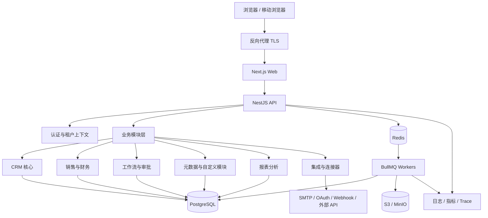
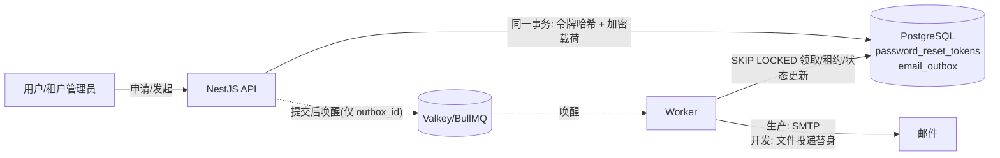
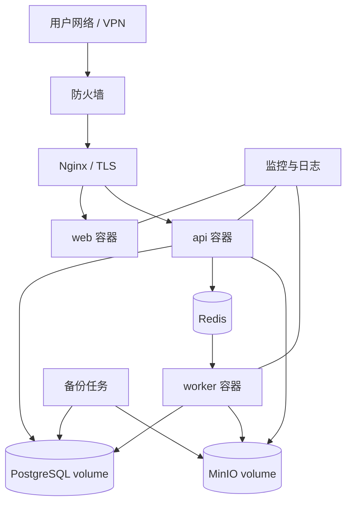

# Yonlink-CRM — 系统架构与部署设计

## 1. 架构决策摘要（ADR）

| 决策 | 方案 | 原因 |
|---|---|---|
| 初期架构 | 模块化单体 | 降低开发、部署、调试复杂度 |
| 前端 | Next.js + React + TypeScript | 企业 Web、路由和组件生态 |
| 后端 | NestJS + TypeScript | 模块边界、依赖注入、验证和测试 |
| API | REST + OpenAPI | 易集成、易生成客户端 |
| 数据库 | PostgreSQL | 关系、事务、JSONB、RLS |
| ORM | Prisma（必要时补充原生 SQL） | 类型安全迁移；复杂 RLS/查询需明确审查 |
| 队列 | Redis + BullMQ | 工作流、通知、导入、Webhook |
| 文件 | S3 兼容存储 / MinIO | 附件、导入文件、导出文件 |
| 部署 | Docker Compose | 私有化部署和可复制环境 |
| 搜索 | 初期 PostgreSQL FTS；规模增长后 OpenSearch | 减少初期运维负担 |
| 国际化 | 前端 i18n + 后端 locale metadata | 文案和业务数据翻译分离 |

## 2. 逻辑架构

## 3. 后端模块边界

每个模块应具有 `domain / application / infrastructure / presentation` 清晰分层；禁止跨模块直接访问其他模块内部 Repository。

建议 NestJS 模块：
- `AuthModule`
- `TenancyModule`
- `OrganizationsModule`
- `UsersModule`
- `AuthorizationModule`
- `AuditModule`
- `LeadsModule`
- `AccountsModule`
- `ContactsModule`
- `DealsModule`
- `ActivitiesModule`
- `ProductsModule`
- `QuotesModule`
- `OrdersModule`
- `WorkflowModule`
- `MetadataModule`
- `ReportingModule`
- `IntegrationModule`
- `FilesModule`
- `NotificationsModule`
- `I18nModule`

模块间通过应用服务接口或领域事件协作。事件应有版本、租户、事件 ID、发生时间和幂等键。

## 4. 请求安全链路

> 2026-11-08 修订：会话与授权链路以 ADR-003、ADR-004（纯服务端会话 + 方案 Y）为准；浏览器会话不使用 JWT。

1. TLS 终止于可信反向代理。
2. API 读取会话 Cookie，计算 Session Token 的 SHA-256，调用 `auth.resolve_session()`：**每个新请求由 PostgreSQL 权威判定**会话存在、未撤销、未过期，用户与租户状态有效；同一语句返回用户级、租户级、全局授权版本与缓存纪元。PostgreSQL 不可用时返回 503。
3. 服务端解析 tenant_id、organization_id、角色和用户偏好（tenant_id 只来自会话，不读取请求参数）。应用层负责租户身份认证与授权；数据库 `app.tenant_id` 只传递已确定的租户供 RLS 与触发器使用，不是租户身份认证（ADR-005 §7）。
4. Authorization Guard 执行模块/动作/记录/字段权限：权限集合按版本组合从 Valkey 读取（`perm:{epoch}:{global}:{tenant}:{tenant_ver}:{user}:{user_ver}`）；未命中或 Valkey 异常时回源 PostgreSQL 计算。Valkey 中**不存储任何会话有效性数据**。
5. Tenant Context 在事务范围传递给 Repository。
6. PostgreSQL RLS 校验租户上下文。
7. 业务操作写入审计日志和 Outbox Event。
8. Worker 从 Outbox/队列消费异步任务。
9. 日志记录 request_id、tenant_id、actor_id；禁止记录密码、token 和敏感明文。

### 4.1 授权版本机制（ADR-004 §2.3，ER §3.9）
| 版本 | 存储位置 | 更新规则 |
|---|---|---|
| 用户级 | `users.authz_version` | `user_roles`、`user_departments` 变更时由触发器在同一事务内 +1 |
| 租户级 | `tenants.authz_version` | `role_permissions`、`roles`（增删/层级）、`departments`（父级、状态、软删除）及租户级权限策略变更时由触发器在同一事务内 +1 |
| 全局 | `system_settings` 行 `authz.global_version` | `permissions` 目录、系统预置角色模板变化及跨租户批量修改 `role_permissions` 的迁移/seed，在同一事务内 +1（触发器 + 迁移检查双重保证） |
| 缓存纪元 | `system_settings` 行 `authz.cache_epoch`（UUID） | 数据库从备份恢复后、或平台运维手动废弃权限缓存时轮换 |

- 版本号只增不减；权限缓存内容按版本组合不可变，旧版本键不会再被读取，**撤权生效不依赖缓存删除**。
- “立即撤销”语义：撤销事务提交后开始的新请求必须被拒绝；执行中的请求不保证自动中断（需中途检查时另立 ADR）。

### 4.2 密码重置与邮件投递（决策 6-2，ER §3.11）

- API 处理申请与确认：自助申请一律返回 202；令牌只存哈希；令牌与 `email_outbox` 任务在同一 PostgreSQL 事务内写入，载荷以 AES-256-GCM 加密（密钥在 `.env`，不入库）。
- **PostgreSQL Outbox 是邮件任务的持久化权威来源**；BullMQ 只负责唤醒与调度，不保存载荷；Worker 每 30 秒轮询 Outbox，Valkey 故障或 BullMQ 任务丢失时不丢任务。
- Worker 负责投递：领取租约、发送前检查令牌状态、退避重试、最终失败告警、终态清理密文；投递语义为至少一次。
- 生产环境通过 SMTP 发送；开发环境使用本地文件投递替身，不新增容器。
- 重置确认在一个事务内消费令牌、更新密码、撤销该用户全部 `auth_sessions`（ADR-004 §2.4）。
- 平台运维账号不使用该流程。

## 5. 多租户与私有化部署模型

- 私有部署并不等于只能有一个租户。建议一套安装支持一个或多个 tenant，便于集团多法人/多事业部隔离。
- 第一版使用共享 PostgreSQL schema + `tenant_id` + RLS。
- 超大型客户未来可选独立数据库/独立部署，但不是第一阶段要求。
- 平台运维管理员与租户业务管理员分离；平台运维默认不具有业务数据读取权限。
- 部署配置、密钥和租户业务数据分离管理。

## 6. 国际化和多币种架构

- 语言：`zh-CN` 默认，`en-US` 第二语言；locale 可按租户和用户设置。
- 时区：IANA timezone，例如 `Asia/Shanghai`；数据库时间均为 UTC。
- 格式：日期、数字、货币格式由 locale 决定，不改变存储值。
- 多币种：ISO 4217 currency code；基础币种、交易币种、汇率快照分别存储。
- 汇率：明确来源、有效时间、人工覆盖、审批和历史锁定规则。
- 税务：税率、税额、含税/未税模式按国家/地区和单据快照处理；不把税制写死在代码中。

## 7. 部署拓扑（单机私有部署起步）

生产部署至少包含：
- `web`、`api`、`worker`、`postgres`、`redis`、`minio`、`nginx`。
- `.env` 仅存密钥引用/环境参数，不提交 Git。
- PostgreSQL 和 MinIO 使用持久卷。
- 只向外暴露 HTTPS；数据库、Redis、MinIO 管理端口不直接暴露公网。
- 健康检查、资源限制、日志轮转、备份、恢复演练。
- 升级前自动备份；数据库迁移向前兼容，提供失败回滚方案。

## 8. 开发环境与代码质量

- Monorepo：pnpm workspaces + Turborepo（可选）。
- 统一 TypeScript、ESLint、Prettier、commit hooks。
- Docker Compose 提供本地依赖服务。
- OpenAPI 作为 API 契约来源。
- CI：lint、typecheck、unit、integration、build、migration check、dependency audit；在本机以 `pnpm ci:local` 执行（不依赖付费 CI，ADR-001）。
- 测试框架：**Vitest 5 全仓统一**（`apps/api`、`apps/worker`、`apps/web`、`packages/*`）；后端 `unplugin-swc` + `@nestjs/testing` + supertest；前端 jsdom + Testing Library；覆盖率 `@vitest/coverage-v8`（ADR-009）。
- E2E：Playwright（单进程），不纳入 Vitest 替代范围。
- 数据库集成测试：独立 Compose 项目 `yonlink-crm-test`（PostgreSQL 768 MB、Valkey 128 MB 上限）；迁移在模板库执行一次，每个测试进程由模板复制独立测试库；所有 RLS 测试以正式运行时角色 `yonlink_app` 连接，并由守卫测试确认非超级用户、无 `BYPASSRLS`、非表属主（ADR-009 §3）。
- 测试并发：单元 ≤ 2 进程，集成 1–2 进程，E2E 1 进程；三类测试串行执行（ADR-007）。
- 测试数据使用 seed；生产环境禁止默认管理员弱密码。
- 依赖版本锁定；定期安全更新。

## 9. 关键架构风险

- RLS 与连接池：必须使用事务级 tenant context，测试连接复用时上下文不会串租户。
- Prisma 与复合租户外键/RLS：必要时用 SQL migration 明确实现，不能只依赖 ORM schema。
- 元数据平台：先定义字段类型、校验、索引和 API 稳定性，再开发拖拽设计器。
- 工作流：必须有版本、执行记录、幂等、超时、重试和死信队列。
- 邮件/消息：发送需要速率限制、退订、同意管理和失败处理。
- 报表：复杂查询必须限制资源，必要时引入异步报表任务或读模型。
